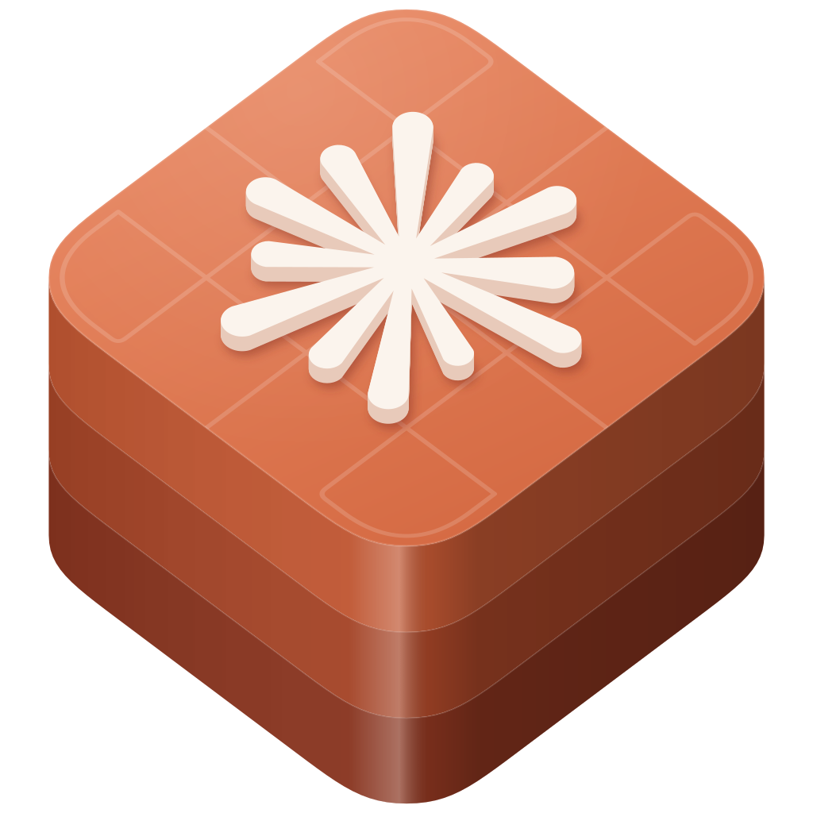

<p align="center">
  <picture>
    <source media="(prefers-color-scheme: dark)" srcset=".github/assets/logo/logo-dark.png">
    
  </picture>
</p>

<h1 align="center">Claude Code</h1>

<p align="center">Computer MCP family plugin for Claude Code CLI and streaming MCP integration.</p>

<p align="center">
  <a href="https://github.com/computer-mcp/plugin-claude/actions/workflows/ci.yml"></a>
  <a href="computer-mcp-plugin.toml"></a>
  <a href="computer-mcp-plugin.toml"></a>
  <a href="LICENSE"></a>
</p>

<p align="center">
  <a href="#install">Install</a> ·
  <a href="#usage">Usage</a> ·
  <a href="docs/Reference/Interface.md">Interface</a> ·
  <a href="docs/README.md">Documentation</a> ·
  <a href="CONTRIBUTING.md">Contributing</a>
</p>

## Overview

An independent [Computer MCP](https://computer-mcp.github.io/) plugin for Claude Code. One
package contributes a canonical CLI tree, a stdio MCP adapter that streams runs, and
client-neutral usage skills. The Python adapter uses the Host vendor execution channel for installed runs.

The CLI contribution describes verified non-interactive commands; the native baseline and its
exact version assertion live in `cli-tree.json`. It is deliberately partial: interactive setup,
installation and unsupported administrative flows are not callable tools. The adapter owns
streaming and session and run state. The Host owns registration, profile grants, working directory, vendor child execution
and audit.

## Quick look

| Contribution | What it adds |
| --- | --- |
| `claude` CLI | Typed tools for the verified non-interactive Claude Code commands |
| `stream` MCP server | `claude.run`, `claude.run.start`, `claude.run.list`, `claude.run.result`, `claude.run.events`, `claude.run.cancel` and `claude.run.release`, plus a work resource listing active runs and retained results |
| `claude-code` skill | Guidance for choosing the CLI or the streaming tools safely |

Install the archive in the host, bind the `claude` executable, and configure both contributions
from `Examples/settings.json`.

## Install

1. Install and authenticate Claude Code yourself, and provide Python 3.13 or newer on the
   Computer MCP launch `PATH`. The plugin never installs or updates either, logs in, creates setup
   tokens or copies credentials.
2. Build the archive:

   ```sh
   python3 scripts/build_package.py /new/output/directory
   ```

3. Install the ZIP through Computer MCP's plugin UI or the owner CLI. Installation is neither
   activation nor a permission grant.
4. Review `Examples/settings.json`, replace its placeholder paths, and configure the plugin
   through the same UI or `plugins configure`. The `claude-code` dependency binding selects
   the executable for both contributions. The installed MCP entry point requires Host negotiation.
   Direct standalone MCP clients can use `bin/claude-mcp-adapter` with `--executable`.

See the [installation guide](docs/Reference/Installation.md) for revisions, configuration
publication and validation.

## Usage

The adapter consumes Claude Code's print-mode stream-json, including partial messages, and keeps
the final result, the native session ID and the native exit outcome independently of cleanup
confirmation. Discovery does not launch Claude Code. Release discards a completed result only after cleanup is confirmed; cleanup
uncertainty stays owned and cannot be released or evicted. The work resource reports each active
run and retained result with its original acquisition reference, so hosts can account for work
after the creating tool returns, without private Host Services permission.

`permission_mode` defaults to `dontAsk`; `plan` and `acceptEdits` are supported explicit choices.
The non-interactive contract exposes no permission-bypass mode and never fabricates interactive
permission responses, and existing vendor configuration continues to apply. Choosing to resume,
continue or start a session is explicit, and cancelling a run does not delete its saved native
conversation.

Installed runs use the Host-selected project and sandbox. The standalone adapter uses
the caller's process environment. Native vendor permissions and credentials still apply. See
the [interface contract](docs/Reference/Interface.md) for retention, cancellation and error
semantics.

## Requirements

- Computer MCP with managed print execution support on an arm64 computer.
- Claude Code, installed and authenticated separately; its version must match `cli-tree.json`.
- Python 3.13 or newer.

## Documentation

The [documentation index](docs/README.md) links the architecture, the interface, the installation
guide and the [release process](docs/Reference/Release.md). To validate a checkout:

```sh
python3 -m unittest discover -s tests -p 'test_*.py' -v
python3 scripts/validate_native.py --executable /absolute/path/to/claude
```

Tests use deterministic peers. The source consumer in `scripts/validate_host.py`
takes explicit clean host/plugin paths and full commit SHAs and stages isolated
snapshots; see the installation guide. The manifest requests provider Project
write, with MCP caller read overrides for list/result/events. CLI still requires
Project write; Skills requires caller Skills and Plugin use. Host approval does
not grant native vendor approval.

The offline sandbox declaration has network none and no config-read exception.
Native config/login/network requirements and the owner runtime-mode choice remain
pending, as do matched-host runtime and signed-App acceptance. Authenticated
execution and production activation are separate acceptance steps.

## Contributing

See the [contributor guide](CONTRIBUTING.md).

## License

Computer MCP-owned code and resources use the
[Functional Source License 1.1, Apache 2.0 Future License](LICENSE) (FSL-1.1-ALv2). Claude Code
and Anthropic services are external; see the [third-party notices](THIRD_PARTY_NOTICES.md).
